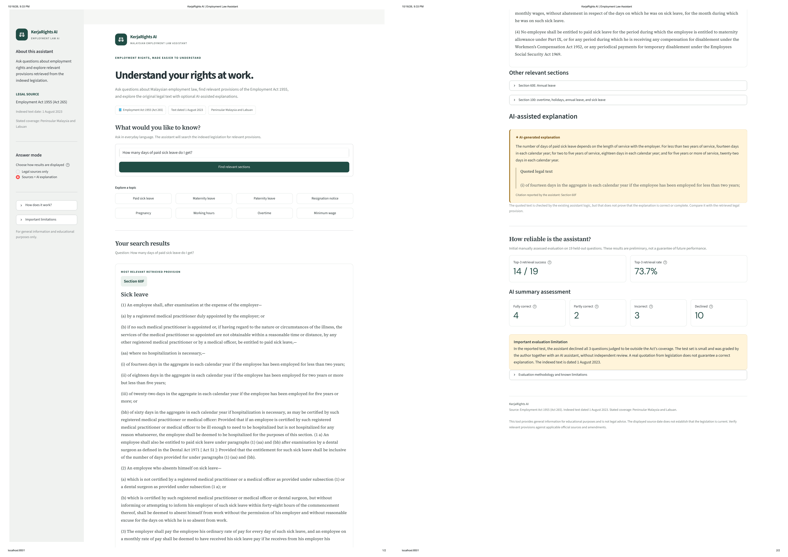
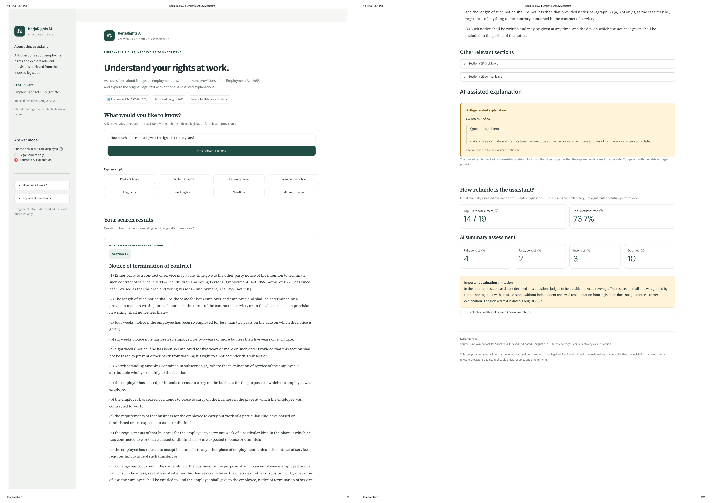

# KerjaRights AI

**A question-answering assistant for Malaysia's Employment Act 1955, built to be measured and not only demonstrated.**

Ask a question about your rights at work in everyday language. The app finds the section of the Act that is closest to it and shows the Act's own words. A small language model that runs on your own computer can add a short summary, but only with a quotation that is checked against the retrieved text.

Every claim about quality in this README comes from a labelled question set that I wrote, ran and graded, including the failures.

**Demo video (2 min 14 s):** https://youtu.be/ksUEnl7VRPs

**Related project:** [Malaysia PM2.5 air quality forecaster](https://github.com/maymyatnoe25/air-quality-forecaster) (live dashboard: https://malaysia-air-quality.streamlit.app)





## Contents

1. [Summary](#summary)
2. [The problem](#the-problem)
3. [How it works](#how-it-works)
4. [Evaluation](#evaluation)
5. [What the evaluation changed](#what-the-evaluation-changed)
6. [Limitations](#limitations)
7. [Responsible use](#responsible-use)
8. [Repository structure](#repository-structure)
9. [Getting started](#getting-started)
10. [Reproducing the evaluation](#reproducing-the-evaluation)
11. [Design decisions and trade-offs](#design-decisions-and-trade-offs)
12. [Future work](#future-work)
13. [Data source](#data-source)
14. [Tech stack and author](#tech-stack-and-author)

## Summary

- **What it is:** hybrid retrieval (keyword search plus embeddings) over the 130 sections of the Employment Act 1955, with an optional summary written by a local 3B-parameter model (`llama3.2`, run through Ollama).
- **Finding the right section:** on 19 held-out questions, the right section was in the top three results for 14 (74%) and ranked first for 9 (47%). Keyword search alone managed 11 (58%) and 3 (16%).
- **The summaries:** on the same 19 questions, the model's summary was fully correct for 4, partly correct for 2, wrong for 3 and declined for 10. It declined all 3 questions that the Act does not cover.
- **The main lesson:** a summary can quote a real sentence from the Act and still give the wrong answer. The app therefore shows the legal text first and labels the summary as machine-generated.

The sample is small (57 questions in total), so treat these numbers as an indication, not a precise rate. The limitations section lists everything that weakens them.

## The problem

Employment law affects every new graduate and intern, but the text is long, formal and hard to search. A general-purpose chatbot can answer quickly, but it may be out of date, may not know Malaysian law, and may state a wrong rule with complete confidence.

This project asks a narrower question: **can a small, free, locally run system point people to the right clause, and how often can it be trusted to explain it?** The aim is a tool that is honest about what it does not know, together with the measurements that show where it fails.

## How it works

```
Act 265 (PDF)
   |  extract text (pypdf)
   v
page text -> remove repeated headers/footers -> split at section numbers -> 130 sections
                                                                               |
                                              cut into ~1,200-character units (218 units)
                                                                               |
question -> BM25 keyword ranking -----------+                                  |
question -> MiniLM embedding similarity ----+-> reciprocal rank fusion -> top 3 sections
                                                                               |
              full text of the 3 sections + question -> llama3.2 (Ollama, local)
                                                                               |
       ANSWER + QUOTE -> quote checked against the sections -> citation assigned by code
```

### 1. Data preparation

- The source is the official Laws of Malaysia reprint of Act 265, "As at 1 August 2023", published by the Commissioner of Law Revision. Its latest amendment is Act A1651, in force from 1 January 2023.
- Page text is extracted with `pypdf`. Repeated page headers and footers are removed, the table of contents is skipped, and the table of amendments at the end of the PDF is cut off.
- The text is split at section numbers. The PDF prints section letters in lowercase (`60a.`, `60fa.`), so these are normalised to `60A` and `60FA`. A line only counts as a new section if its number is at most 20 above the previous one, which stops stray numbered lines from creating fake sections.
- The result is **130 chunks** (128 sections plus the two Schedules), with a median length of 699 characters. The longest is section 2 (definitions) at 12,441 characters.
- Unit tests check the header removal, the lowercase section letters and the amendment-table cut-off.

### 2. Retrieval

- **Units.** Each section is split at paragraph boundaries into units of up to 1,200 characters. Each unit starts with its section number and heading, so any result can be traced to a section. This gives 218 units.
- **Keyword search.** BM25 (`rank-bm25`) with simple stopword removal.
- **Meaning search.** Sentence embeddings (`all-MiniLM-L6-v2`), compared by cosine similarity. Embeddings are cached on disk.
- **Hybrid search.** Both rankings are combined with reciprocal rank fusion (each result earns `1 / (60 + rank)` from each method), which avoids having to match the two scoring scales.
- **Output.** The best unit of each section is kept, and the top three sections are returned.

### 3. Answer generation

The model is given the full text of the top three sections (each capped at 4,000 characters) and must reply in a fixed format:

```
ANSWER: <1 to 3 plain sentences>
QUOTE:  <words copied exactly from one of the sections>
```

or the single word `NOT_FOUND`. The code then:

1. checks the quote against each retrieved section, accepting it if at least 80% of the quote's four-word sequences appear in that section;
2. **assigns the citation itself** from the section where the quote was found, because the model's own section numbers were unreliable (see below);
3. replaces the answer with a refusal if the quote cannot be found.

This check proves that the quote exists in the Act. It does not prove that the answer is correct, and the evaluation shows cases where it is not.

### 4. Interface

A Streamlit app, `app/rag_app.py`. The matched section is shown first as a reading panel, with the other two retrieved sections below it. The summary comes second, in a separate amber block marked as machine-generated, with its quotation. If Ollama is not running, the app falls back to sources only. The reliability results are on the page itself.

## Evaluation

### Question set

57 questions, each labelled with the section(s) that answer it, or marked as not covered by the Act. The labels were checked against the text of the Act, not taken from the search output. The questions were drafted with an AI assistant.

| Split | Answerable | Not in the Act | Total |
|---|---|---|---|
| Development (used for tuning) | 26 | 9 | 35 |
| Test (held out) | 19 | 3 | 22 |
| **Total** | **45** | **12** | **57** |

The "not in the Act" questions ask about things such as the minimum wage, EPF contributions, income tax and probation periods. They test whether the system refuses instead of inventing an answer. Each one was checked by searching the Act's text for the topic.

**Metrics.** `hit@k` is the share of questions where a correct section is in the top *k* results. MRR (mean reciprocal rank) averages 1 / (rank of the first correct section). Both are measured at **section level**, and a question with two correct sections counts as a hit if either is found.

**Process rules.**
- The final setup was written to `eval/DECISIONS.md` and committed before the test split was run.
- `python -m src.evaluate` shows only the development split. The test split needs `--final`.
- The test split was run once for retrieval and once for generation.
- One early retrieval table that included the test split was seen before any tuning (using `bge-small`). No decision was made from it.

### Retrieval results

Final setup: MiniLM embeddings, 1,200-character units, hybrid search. It was chosen on the development set.

| Method | Dev hit@1 | Dev hit@3 | Dev MRR | Test hit@1 | Test hit@3 | Test hit@5 | Test MRR |
|---|---|---|---|---|---|---|---|
| Keyword (BM25) | 0.50 | 0.85 | 0.67 | 0.16 | 0.58 | 0.84 | 0.41 |
| Meaning (MiniLM) | 0.77 | 0.92 | 0.84 | 0.58 | 0.79 | 0.84 | 0.71 |
| **Hybrid (chosen)** | **0.81** | **0.96** | **0.88** | **0.47** | **0.74** | **0.84** | **0.64** |

What this shows:
- **Meaning search beats keyword search** on both splits. The Act says "paternity leave" and "confinement", while people write "fathers" and "baby". It says "termination of contract" where people write "resign".
- **Test results are much lower than development results** (hit@3 fell from 0.96 to 0.74). Possible reasons, none of which I tested: the final setup was the best of about 20 tried on only 26 questions; development labels were corrected after seeing development misses and test labels never were; and my test questions are longer scenario-style questions.
- **Meaning search alone scored higher than hybrid on the test split** (hit@1 0.58 against 0.47). The difference is one or two questions out of 19, and I did not switch the choice afterwards, because that would defeat the point of a held-out set.
- With 19 test questions, one question is worth about 5 percentage points.

### Experiments on the development set

All 18 combinations of unit size (whole sections, 600 and 1,200 characters), embedding model (`all-MiniLM-L6-v2` and `bge-small-en-v1.5`) and search mode, scored on the 26 answerable development questions.

<details>
<summary>Full table (18 rows)</summary>

| Unit size | Units | Model | Mode | hit@1 | hit@3 | hit@5 | MRR |
|---|---|---|---|---|---|---|---|
| whole sections | 130 | minilm | keyword | 0.54 | 0.85 | 0.85 | 0.69 |
| whole sections | 130 | minilm | meaning | 0.62 | 0.88 | 0.96 | 0.74 |
| whole sections | 130 | minilm | hybrid | 0.73 | 0.88 | 0.92 | 0.81 |
| whole sections | 130 | bge-small | keyword | 0.54 | 0.85 | 0.85 | 0.69 |
| whole sections | 130 | bge-small | meaning | 0.73 | 0.88 | 0.88 | 0.81 |
| whole sections | 130 | bge-small | hybrid | 0.73 | 0.88 | 0.96 | 0.83 |
| 600 | 371 | minilm | keyword | 0.46 | 0.69 | 0.88 | 0.62 |
| 600 | 371 | minilm | meaning | 0.81 | 0.92 | 0.96 | 0.87 |
| 600 | 371 | minilm | hybrid | 0.77 | 0.92 | 0.92 | 0.85 |
| 600 | 371 | bge-small | keyword | 0.46 | 0.69 | 0.88 | 0.62 |
| 600 | 371 | bge-small | meaning | 0.81 | 0.88 | 0.92 | 0.87 |
| 600 | 371 | bge-small | hybrid | 0.69 | 0.92 | 0.92 | 0.81 |
| 1,200 | 218 | minilm | keyword | 0.50 | 0.85 | 0.88 | 0.67 |
| 1,200 | 218 | minilm | meaning | 0.77 | 0.92 | 0.92 | 0.84 |
| 1,200 | 218 | minilm | hybrid | 0.81 | 0.96 | 0.96 | 0.88 |
| 1,200 | 218 | bge-small | keyword | 0.50 | 0.85 | 0.88 | 0.67 |
| 1,200 | 218 | bge-small | meaning | 0.77 | 0.85 | 0.96 | 0.83 |
| 1,200 | 218 | bge-small | hybrid | 0.73 | 0.96 | 0.96 | 0.83 |

</details>

- Keyword search got worse with smaller units (hit@3 fell from 0.85 to 0.69 at 600 characters). I did not test why.
- The two embedding models performed about equally, so the smaller one was kept.
- The top rows were within one question of each other. One question is worth about 4 points, so I do not claim a clear winner. The selection effect described above applies.

**A reranker did not help.** I tried a cross-encoder (`ms-marco-MiniLM-L-6-v2`) to reorder the top 20 hybrid results, and it made first-place results worse at both unit sizes, so it is not used.

| Unit size | Setup | hit@1 | hit@3 | hit@5 | MRR |
|---|---|---|---|---|---|
| 1,200 | hybrid | 0.81 | 0.96 | 0.96 | 0.88 |
| 1,200 | hybrid + reranker | 0.58 | 0.88 | 0.96 | 0.75 |
| 600 | hybrid | 0.77 | 0.92 | 0.92 | 0.85 |
| 600 | hybrid + reranker | 0.65 | 0.88 | 0.96 | 0.79 |

### Answer generation results

Four versions of the generator were compared on the development set (26 answerable and 9 not-in-the-Act questions). They differ in who writes the citation and how strictly the quote is checked.

| | v1: model cites, no check | v2: exact quote check | v3: fuzzy quote check | v3 with gemma3:4b |
|---|---|---|---|---|
| Answerable questions answered (of 26) | 26 | 13 | 17 | 25 |
| Cited a correct section | 16 | 13 | 15 | 21 |
| Cited a section it was not shown | 6 | 0 | 0 | 0 |
| Not-in-the-Act questions handled correctly (of 9) | 8 | 9 | 9 | 6 |

Notes on the table:
- v1 "handled correctly" is 8 of 9 after I corrected a scoring bug: six refusals were written as `NOTFOUND` without the underscore and were counted as answers.
- For `gemma3:4b`, 6 of 9 were handled correctly, 1 was mixed (it said the Act does not address two jobs, then speculated) and 2 were answered as if the Act covered them. The refusals were written in plain words ("the Act does not specify...") and not as `NOT_FOUND`.
- I read the answers that passed the check. By my reading, of the 17 `llama3.2` answers, 7 were correct, 3 correct but incomplete, 4 partly wrong or misleading and 3 wrong. Of the 25 `gemma3:4b` answers, 13 were correct, 8 partly correct and 4 wrong.
- I chose `llama3.2` using a rule written before the test run: first, never answer a question the Act does not cover; second, maximise correct answers. `gemma3:4b` answers more questions but fails the first rule more often.

**Held-out test results (`llama3.2`, v3, run once; 19 answerable questions):**

| Outcome | Count |
|---|---|
| Right section among the top 3 | 14 of 19 |
| Fully correct summary | 4 |
| Partly correct | 2 |
| Wrong | 3 |
| Declined although the right section was shown | 7 |
| Declined because the right section was not retrieved | 3 |
| Questions not in the Act that were declined | 3 of 3 |
| Citations to sections the model was not shown | 0 |

On the development set the same generator answered 17 of 26 and cited a correct section for 15, so the test numbers are lower there too. Only 19 questions went into this table.

### Failure analysis

These are real failures from the logs, kept deliberately.

1. **The right section, the wrong part.** Retrieval returned section 60F (sick leave) first, but the unit shown to the model was the second half of the section. The numbers (14, 18, 22 and 60 days) are in subsection (1), so the model correctly answered `NOT_FOUND`. I now give the model the full text of each retrieved section. Section-level hit rates cannot see this problem, and they overstate how often the model gets the information it needs.
2. **A real quotation with a wrong answer.** Asked how much notice an employee with three years of service must give, the model answered four weeks, which is the tier for under two years. Section 12 gives six weeks. Phrased slightly differently (as "resign after three years") it answered correctly, so the behaviour is brittle.
3. **Right quote, wrong rule.** "Does my employer have to give me a day off every week?" was answered "No", quoting the exception for shift workers, when section 59 says every employee shall be allowed a weekly rest day. "Do I also get paid sick leave on maternity leave?" was answered "yes" from a rule about annual leave, but section 60F(4) says there is none during the maternity allowance period.
4. **Stretching a related section.** `gemma3:4b` answered a question about civil servants' leave with the annual leave days of section 60E, and a question about redundancy benefits from a section about the Director General deciding wage disputes.
5. **Vocabulary gaps in retrieval.** A question about asking to work from home missed section 60Q because the Act says "flexible working arrangement". A question about quitting after a proven harassment complaint missed section 81E, and the model then answered from the wrong section (81C).
6. **Invented content.** In an early version the model produced a made-up definition of "wages" and a "14 days' notice" rule that appear in no retrieved text. The quote check removed these.
7. **Over-caution.** On the test split, the model declined 7 questions although the answering section was in front of it.
8. **Incomplete answers.** The sick leave summary lists 14, 18 and 22 days and omits the 60 days when hospitalisation is needed.

## What the evaluation changed

| What I saw | What I changed |
|---|---|
| Sick leave returned `NOT_FOUND` although section 60F was retrieved. | The model now reads the full section, not one unit of it. |
| The model's section numbers were wrong (for example `s37F`, `s3F`, `s60F` for rest day pay). | The code assigns the citation from where the verified quote was found. |
| An exact quote check refused 13 of 26 answerable questions. | The check now tolerates small differences (80% of four-word sequences). |
| Refusals written as `NOTFOUND` or in plain words were scored as answers. | The scoring now reads refusals in several forms. Lesson: read the answers before trusting a count. |
| A reranker lowered first-place results. | It was left out. |
| The test table appeared while I was still tuning. | The test split now requires an explicit `--final` flag. |
| A summary could be wrong with a real quote. | The app shows the legal text first and the summary second, labelled as machine-generated. |

## Limitations

- **Small evaluation.** 57 questions, 19 answerable ones held out. The results indicate trends and are not precise rates.
- **Not fully independent.** The questions were drafted with an AI assistant. The 22 test questions were written after I had seen which development questions failed. One early test table was seen before tuning.
- **Selection effect.** The final setup was the best of about 20 configurations on 26 questions, so its development scores are optimistic. The lower test scores are the better guide.
- **Grading.** I graded the answers myself with the help of an AI assistant, without an independent reviewer. Some labels or grades may be wrong.
- **Section-level scoring.** A hit means that the right section was retrieved, not that the right subsection reached the model. Questions with two correct sections count as hits if either is found.
- **Small local model.** A 3B model sometimes refuses when it should answer, and sometimes answers from the wrong clause. Its summaries are the weakest part of the system.
- **Text of the law.** The indexed text is the reprint "As at 1 August 2023". I did not check for later amendments. Regulations and orders made under the Act are not included, and some entitlements depend on them.
- **Coverage.** The Act applies to Peninsular Malaysia and Labuan. Sabah and Sarawak have their own labour laws, which are not covered. Whether a particular person counts as an "employee" (see section 2 and the First Schedule), or whether an internship counts as employment, is not decided by the assistant.
- **Language.** English only.
- **Extraction quality.** A few section headings are imperfect (for example sections 19, 60J and 60P), and long sections are capped at 4,000 characters in the prompt.
- **Hardware.** Developed on a Windows laptop with 15 GB of RAM and no dedicated graphics card. Models run on the CPU.
- **Hosting.** The app runs locally. The summaries need Ollama, which free hosting platforms do not provide.

## Responsible use

This is an educational project and **not legal advice**. The app displays the source date next to every result, always shows the original text, refuses instead of guessing when it cannot support an answer, and states that summaries can be wrong. For a real employment problem, check the full Act and any regulations, and contact the Labour Department or a qualified lawyer.

## Repository structure

```
app/
  rag_app.py            Streamlit interface
src/
  download.py           fetch the Act PDF (manual download also works)
  extract.py            PDF -> page text (JSON)
  chunk.py              page text -> sections (JSONL)
  search.py             units, tokenising, BM25 keyword index
  retrieve.py           embeddings, hybrid retrieval (reciprocal rank fusion)
  generate.py           prompt, local model call, quote check, citations
  evaluate.py           retrieval metrics on the question set
  experiments.py        grid over unit size, embedding model, search mode
  rerank_experiment.py  cross-encoder reranker test
  eval_generation.py    run the generator over a question split
  problems.py, problems_v2.py   reports of failed answers
  show.py, context.py, review.py, audit.py   tools for reading the Act and checking labels
eval/
  questions.txt         the 57 labelled questions
  DECISIONS.md          decisions recorded before the test run
  results_dev.json      the 18-row experiment results
  generations_*         model outputs for every run
tests/                  unit tests (chunking, search, retrieval helpers, metrics)
docs/                   screenshots
.streamlit/config.toml  Streamlit settings
```

The Act's text and the derived data (`data/`) are not stored in the repository.

## Getting started

Requirements: Python 3.13 (other recent versions may work, but I only used 3.13), about 5 GB of disk space for the Python packages and models, and a Windows, macOS or Linux machine. The commands below are for Windows PowerShell.

**1. Clone and install**

```powershell
git clone https://github.com/maymyatnoe25/malaysia-employment-rag.git
cd malaysia-employment-rag
python -m venv .venv
.\.venv\Scripts\Activate.ps1
pip install -r requirements.txt
```

On macOS or Linux, activate with `source .venv/bin/activate`.

**2. Get the Act**

Download the English reprint of Act 265 from the Attorney General's Chambers (`lom.agc.gov.my`) and save it as `data/raw/employment_act_1955.pdf`. The file used here is:

```
https://lom.agc.gov.my/ilims/upload/portal/akta/outputaktap/1744567_BI/Reprint%20Act%20265%20(Final).pdf
```

`python -m src.download` tries to fetch it automatically, but the server may block scripts, so manual download is the reliable route. **Check the cover page.** It must read "Reprint ... As at 1 August 2023". The site also offers an older text ("As at 30 April 2012") that lacks the 2022 amendments.

**3. Build the index data**

```powershell
python -m src.extract
python -m src.chunk
python -m pytest -v
```

`src.chunk` should report 130 chunks. The first search later downloads the embedding model from Hugging Face, so allow a few minutes and an internet connection. Messages about unauthenticated requests or symlinks are harmless.

**4. Install a local model (optional, for summaries)**

Install [Ollama](https://ollama.com), then:

```powershell
ollama pull llama3.2
```

**5. Run the app**

```powershell
streamlit run app/rag_app.py
```

Without Ollama, the app still works in sources-only mode.

**Try it from the command line**

```powershell
python -m src.show s60F
python -m src.retrieve "How much notice must I give if I resign?"
python -m src.generate "How many days of paid sick leave do I get?"
```

## Reproducing the evaluation

```powershell
python -m src.evaluate                                      # development split only
python -m src.evaluate --final --chars 1200 --model minilm  # also scores the held-out test split
python -m src.experiments                                   # the 18-row grid
python -m src.rerank_experiment                             # reranker test
python -m src.eval_generation --split dev --tag v3          # generation on the development split
python -m src.problems_v2 v3                                # list answered, refused and rejected cases
```

`src.evaluate` defaults to the `bge-small` model, so the final setup is passed explicitly with `--model minilm`. Running `--split test` or `--final` again repeats the held-out evaluation. If you tune anything after looking at its results, that split is no longer held out.

## Design decisions and trade-offs

| Decision | Alternatives | Reason |
|---|---|---|
| Split by section number | Fixed-size character windows | Each result maps to a citable section. |
| Units of about 1,200 characters | Whole sections, 600 characters | Best development scores. Whole sections are too long for the embedding model, and 600 hurt keyword search. |
| Hybrid search with rank fusion | Keyword only, meaning only | The two methods fail on different questions. Fusion needs no score calibration. |
| MiniLM embeddings | `bge-small` | About equal on development data, and smaller. |
| No reranker | Cross-encoder | It lowered first-place results on development data. |
| Full sections in the prompt | The retrieved unit only | The retrieved unit often missed the numbers. |
| Quote check plus code-assigned citations | Trusting the model's citations | The model's section numbers were frequently wrong. |
| `llama3.2` | `gemma3:4b` | It was safer on questions outside the Act. |
| Legal text first, summary second | Summary as the main answer | The summaries were correct for only 4 of 19 test questions. |
| A local model | A hosted API | Free, private, and reproducible without an API key. |

## Future work

- Have a second person grade the answers and write part of the test questions, to give a more independent evaluation.
- Extend the question set and score retrieval at subsection level, not section level.
- Give the model only the relevant subsection instead of the whole section, and test larger local models.
- Improve heading extraction and handle the sections whose headings are polluted.
- Add the regulations made under the Act, and track amendments after August 2023.
- Add Malay-language questions.
- Check the reuse terms of the source text and host a public retrieval-only version.

## Data source

The text of the Employment Act 1955 (Act 265) comes from the Laws of Malaysia reprint "As at 1 August 2023", published by the Commissioner of Law Revision, Malaysia, obtained from the Attorney General's Chambers site (`lom.agc.gov.my`) on 12 October 2026. The text is not redistributed in this repository, and I have not checked the site's terms of reuse. Official sources and any later amendments take precedence over everything here.

## Tech stack and author

Python 3.13, `pypdf`, `rank-bm25`, `sentence-transformers` (`all-MiniLM-L6-v2`, `BAAI/bge-small-en-v1.5`, `cross-encoder/ms-marco-MiniLM-L-6-v2`), Ollama (`llama3.2`, `gemma3:4b`), Streamlit and `pytest`.

Built by May Myat Noe Lwin ([@maymyatnoe25](https://github.com/maymyatnoe25)), October 2026, as part of a data science portfolio.
